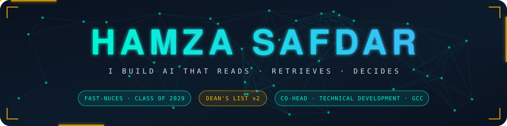
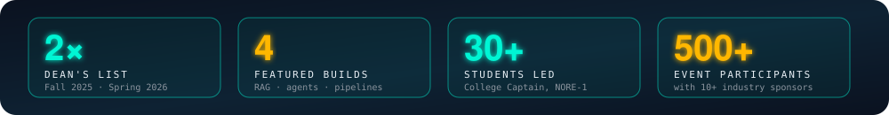
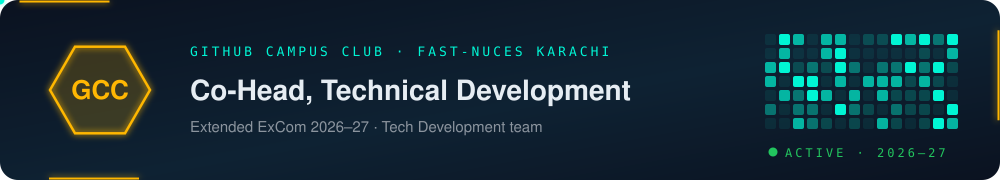
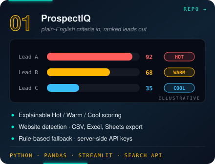
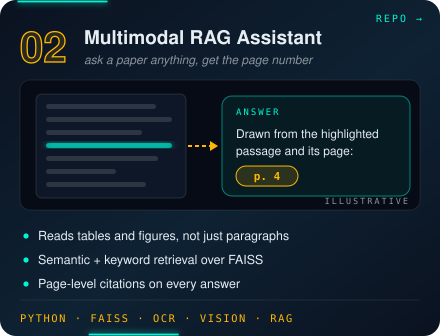
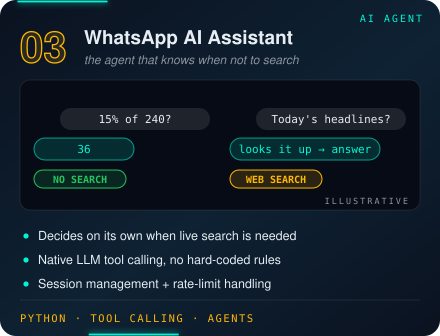
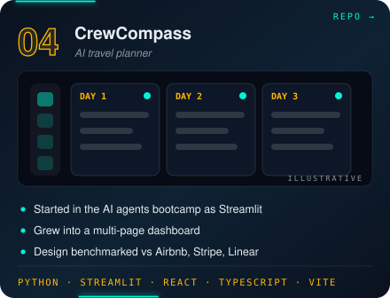
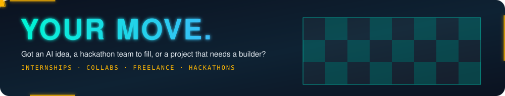

  

  

 

<h2>🧑‍💻 LEADERSHIP</h2>

 

<h2>🗂️ THE SOURCES</h2>

 

  

<h2>🧰 ARSENAL</h2>

 

<h2 align="center">🏅 TROPHY ROOM</h2>

| | Milestone | When |
|:-:|:--|:--|
| 🎓 | **Dean's List of Honors**, FAST-NUCES | Fall 2025 · Spring 2026 |
| 🧑‍💻 | **Co-Head, Technical Development**, GitHub Campus Club FAST-NUCES | 2026–27 |
| 🏁 | **ACM Coders Cup** · **PROCOM'26 Code Sprint** · **PROCOM'26 Interstellar Intelligence** | 2025–26 |
| 🤝 | **Developers' Day '26 team** · CodeSprint challenges, ACM FAST-NUCES | 2026 |
| 👑 | **College Captain**, Bahria College NORE-1: led 30+ council members, events of 500+ people, 10+ industry sponsors | 2024–25 |
| 📜 | **Certified:** Amazon (Software Development · Java · DSA) · Google (Python) | n/a |

 

 

