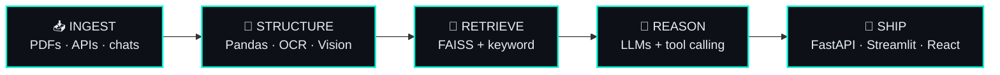
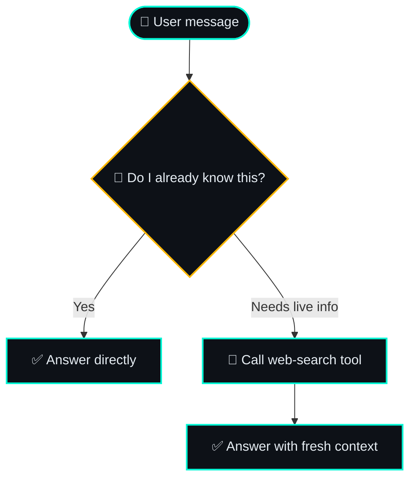

<!-- ╔══════════════════════ HEADER ══════════════════════╗ -->
<div align="center">


<a href="https://git.io/typing-svg">
  
</a>

<br/><br/>

<a href="https://linkedin.com/in/hamzasafdar04"></a>
<a href="mailto:hamzasafdar7007@gmail.com"></a>
<a href="https://github.com/Hamza-04-mav?tab=repositories"></a>


</div>

<br/>

```bash
$ whoami
hamza_safdar — CS undergrad @ FAST-NUCES Karachi  (2025 → 2029)

$ cat focus.txt
RAG · LLM tool calling · AI agents · live-data pipelines · full-stack web

$ git log --role
Co-Head, Tech Development @ GitHub Campus Club FAST-NUCES  (2026–27)

$ echo $MISSION
"Build reliable, data-driven software that solves real problems."
```

I care about the unglamorous parts of AI that make it actually work: **fallbacks, rate limits, secret handling, citations, and explainable scores.** A demo answers once. A system keeps answering.

<br/>

## ⚙️ How I Build



<br/>

## 🗂️ Case Files

### `01` · [ProspectIQ](https://github.com/Hamza-04-mav/ProspectIQ) — *plain-English criteria in, ranked leads out*

```text
natural-language criteria ─► live search API ─► Pandas ─► 0–100 score ─► CSV · Excel · Google Sheets
```

- **Explainable scoring:** every lead gets a Hot / Warm / Cool rating you can trace back to reasons
- **Website-presence detection** to separate ready-to-pitch leads from the rest
- **Reliability built in:** rule-based fallback parser + server-side credential handling, so API keys never reach the browser

`Python` `Pandas` `Streamlit` `Search API`

<br/>

### `02` · [Multimodal RAG Research Assistant](https://github.com/Hamza-04-mav/multimodal-rag) — *ask a paper anything, get the page number*

```text
PDF ─► text + tables + figures ─► OCR / vision ─► FAISS + keyword search ─► answer with page-level citations
```

- Reads what plain text extraction misses: **tables and figures**, not just paragraphs
- Hybrid retrieval (semantic + keyword) so exact terms and fuzzy meaning both land
- Tested on the *Attention Is All You Need* paper

`Python` `FAISS` `OCR` `Vision` `RAG`

<br/>

### `03` · WhatsApp AI Assistant — *the agent that knows when **not** to search*



- Native **LLM tool calling**: the model decides, not a hard-coded rule
- Session management + rate-limit handling so it stays up under real use

`Python` `Tool Calling` `Agents`

<br/>

### `04` · [CrewCompass](https://github.com/Hamza-04-mav/travel-planner-app) — *AI travel planner*

Born in the AI agents bootcamp as a Streamlit app and iterated toward a polished multi-page dashboard, with design benchmarked against products like Airbnb, Stripe, and Linear.

`Python` `Streamlit` `React` `TypeScript` `Vite`

<br/>

## 🔭 In the Lab

| 🧪 Building | 🌱 Leveling up |
|:--|:--|
| **UniBox** — a Chrome extension (Manifest V3) that uses AI to sort a university Gmail inbox into categories it discovers on its own | AI agents bootcamp: RAG, vector databases, prompt engineering, agent frameworks |
| **Finderr** — a student lost & found platform (Supabase auth, database, storage, realtime chat) | Production-grade backends, multimodal AI, agentic workflows |

<br/>

## 🧰 Skill Tree

| Domain | Arsenal |
|:--|:--|
| 🧠 **AI & Data** |        |
| ⚙️ **Backend** |      |
| 🎨 **Frontend** |       |
| 🔩 **Languages** |     |
| 🛠️ **Tools** |      |
| 📐 **Core CS** | `Data Structures & Algorithms` · `Object-Oriented Programming` · `Problem Solving` |

<br/>

## 🏅 Trophy Room

| | Milestone | When |
|:-:|:--|:--|
| 🎓 | **Dean's List of Honors** — FAST-NUCES | Fall 2025 · Spring 2026 |
| 🧑‍💻 | **Co-Head, Tech Development** — GitHub Campus Club FAST-NUCES | 2026–27 |
| 🏁 | **ACM Coders Cup** · **PROCOM'26 Code Sprint** · **PROCOM'26 Interstellar Intelligence** | 2025–26 |
| 🤝 | **Developers' Day '26 team** · CodeSprint challenges, ACM FAST-NUCES | 2026 |
| 👑 | **College Captain**, Bahria College NORE-1: led 30+ council members, events of 500+ people, 10+ industry sponsors | 2024–25 |
| 📜 | **Certified:** Amazon (Software Development · Java · DSA) · Google (Python) | — |

<br/>

## 📡 Telemetry

<div align="center">


</div>

<br/>

## ♟️ Your Move

I play chess, so I like thinking a few moves ahead. If you've got an **AI idea**, a **hackathon team to fill**, or a **project that needs a builder**, I'd like to hear it.

- 🎯 **Internships & collabs:** AI/ML engineering, agentic systems, full-stack
- 💼 **Freelance:** AI/ML and web development, plus content writing and academic editing


<div align="center">

<a href="https://linkedin.com/in/hamzasafdar04"></a>
<a href="mailto:hamzasafdar7007@gmail.com"></a>

<br/><br/>


</div>
